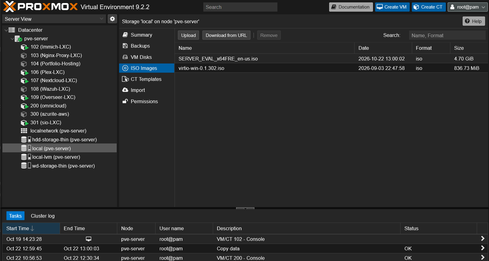

# Microsoft Server - Active Directory

# Installation and Proxmox Setup

1. Download Microsoft Server 2022 from Microsoft https://www.microsoft.com/en-us/evalcenter/download-windows-server-2022.
2. Download the Virtio drivers for Windows, because it doesn’t include native, built-in drivers for KVM/QEMU paravirtualized hardware devices. https://fedorapeople.org/groups/virt/virtio-win/direct-downloads/archive-virtio/virtio-win-0.1.302-1/
3. Upload both the Windows Server ISO and Virtio drivers to Proxmox. Easiest way is uploading via Proxmox VE Web UI, but can be done as well through the terminal using SSH and SCP.

## VM Setup

1. Create a VM with the following resources.

- Enable discard in Disks, this allows Proxmox and guest OS to reclaim deleted file space automatically.
- TPM is also not setup BUT RECOMMENDED in a production environment, allowing modern security features like BitLocker, Shielded VMs, etc.

# Windows Server VM Initial Startup

2. It will boot into the ISO file that was attached earlier.

3. Click next and install now, and it will ask which version of the OS to install. Install the Desktop Experience so that there is a GUI, as the core version boots you directly into a CLI.

4. This is where Virtio drivers will be attached and used. Select custom install and it will ask where to install the OS.

5. In Proxmox, go to the Hardware tab and replace the existing CD/DVD Drive from the Windows Server ISO to Virtio ISO. **_This does not need a restart, you can go back to console instantly_**

6. Click on Load driver and it will load the available Virtio drivers. Select the year corresponding to the Windows Server, which in this case is 2K22 version, and click next.

7. You can now install the OS in the detected drive that was setup earlier. If you get the message that the OS can’t be installed, that is because the ISO was switched to Virtio drivers in the Hardware tab, switch it back to the Windows Server ISO and click refresh in the Setup.

8. It will now finalize and install the OS.

9. Set a strong password or it will reject it.

10. The VM is now fully setup.

# Windows Server VM & Active Directory Setup

## Virtio Drivers setup for Internet access and drivers

1. There will be no Internet out-of-box, so ensure the Virtio drivers are attached in the Hardware tab in Proxmox for this VM. I attached it already so I can access the drivers needed to install. Install the Virtio x64 exe file. **_By default the exe file will want to install everything needed so there is no need to configure the installer further_**

2. The server now has Internet access and all drivers have been installed.

## Assigning Static IP Address for the Server

3. Win + R and ncpa.cpl to open Network Configurations.

4. Click on the current network adapter and configure it’s static IP, by editing properties of IPv4 connection.

- Ping or ARP can be used to find a free IP. I used ping and ARP to check whether an IP is available. I will be setting the IP of this server to 192.168.1.50.

5. This is the correct network configuration for this VM.

- The Static IP which is confirmed to be available and unused.
- The Default Gateway which points to the home router.
- The DNS server must be loopback address so it guarantees AD resolves instantly. This is because the AD relies on DNS to locate domain controllers.
- An alternative DNS pointing to Google for Internet fallback.

6. Confirm in CMD using _ipconfig_ that the static IP has been applied.

# Active Directory Installation

1. Open Server Manager dashboard < Manage < Add Roles and Features and select RBAC Installation.

2. Select the Windows Server from the Server Pool.

3. Check the Active Directory Domain Services box and Add Features. Additional features can be installed in the next page if needed.

4. Confirmation tab will show a summary of the features to be added. Installation will start after clicking Install.

5. Installation complete. Wizard can be closed now.

# Server Domain Controller Setup

1. The notification flag prompts to “promote the server to a domain controller”. Click on this to setup.

2. Add a new forest and provide root domain name.

- A forest is the top-level security and admin boundary that contains all domains, OUs, users, and computers.
- Adding a new forest means building a brand-new AD from scratch.

3. Let Domain Functional Level to default as Windows Server 2016. This is default and highest functional level for Windows Server 2022. Select a strong password and ensure this password is kept securely.

4. DNS delegation warning “cannot be created” is normal for a **new root domain**, just click next.

5. The NetBIOS domain name will populate itself based on your hostname that was setup from earlier. This can be changed too if needed.

6. These are the default paths for AD DS database, log files, and SYSVOL and will not be changed unless specified for a specific use case.

7. The wizard shows the summary of configurations to be applied.

8. Ensure configurations pass all the prerequisites check. Install and the server will reboot.

9. The server automatically restarts after the installation.

# Active Directory Setup

1. The updated hostname has now been applied to the server.

2. The AD is now ready to be set up.

## Building OU Structure

1. There are two ways to setup the OUs, through dsa.msc legacy console or the modern Active Directory Administrative Center (ADAC) in Server Manager Tools.

2. To create the Top-Level Root OU, right click on the AD host and click on New > Organizational Unit. I will name this OU “Tenant” and protect from accidental deletion. **This is the Root Level OU**

3. I will create a specific Tenant now under Tenant and will name it a placeholder company name.

4. Under AlphaSystems tenant, I will create sub-functional OUs that represents Object Types and Security Tiers. Example. Users, Computers, Groups, Administrative, etc.

- Best practice is assigning permissions to Groups, rather than single users, so I will create an OU for Groups.

5. Create a new Group under the Groups OU, I will name this under the standard naming convention with SG being Security Groups.

6. I will now create another OU under AlphaSystems which will have the Users. Standard naming convention for this; it will be called Users.

7. Create a new user under the Users OU.

8. Provide the user a secure password for now and ensure the user can change password at next logon; this is production standard.

9. Assign the User by double clicking them, select “Member Of”, Add and specific Group that they will be assigned to. An alternative way of doing this is through the Groups, and adding the User there itself.

